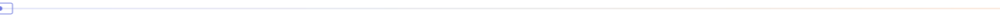

  <a href="https://abdulsametkilic.github.io/"><b>Portfolio</b></a> &nbsp;·&nbsp;
  <a href="https://www.linkedin.com/in/abdulsamet-k%C4%B1l%C4%B1%C3%A7/"><b>LinkedIn</b></a> &nbsp;·&nbsp;
  <a href="mailto:sametklgs@gmail.com"><b>Email</b></a> &nbsp;·&nbsp;
  <a href="https://leetcode.com/u/abdulsametklc/"><b>LeetCode</b></a>

I'm a computer engineer focused on **computer vision and real-time systems**, with hands-on full stack and LLM experience. I turn AI models into products that work.

Open to Computer Vision and AI roles, in Istanbul or remote.

### Highlights

- **TEKNOFEST Combat UAV finalist, 2024 and 2026.** Founding captain of the ATA Simurg UAV team.
- **Algi AI.** Built multi-camera vehicle tracking with DeepStream and ReID on a live map, a stock management product, and a multi-provider GPU rental marketplace.
- **Turkcell Code Night.** 2nd place with [MarketCell](https://github.com/Abdulsametklc/marketcell), All Star competitor with [NetOpsCell](https://github.com/Abdulsametklc/NetOpsCell).
- **Community.** Founding president of the AI & Technology Club; led DevFest Erzurum (1000+) and the Erzurum AI Summit (800+).

### Selected work

<table>
  <tr>
    <td width="50%" valign="top">
       
      <a href="https://github.com/Abdulsametklc/visionkit"><b>visionkit</b></a> 
      Object tracking algorithms and activation functions, implemented from scratch.
    </td>
    <td width="50%" valign="top">
       
      <a href="https://github.com/Abdulsametklc/uav-tracker-evaluation"><b>uav-tracker-evaluation</b></a> 
      Benchmarks tracking algorithms on accuracy, stability, speed, and resource use under one pipeline.
    </td>
  </tr>
  <tr>
    <td width="50%" valign="top">
       
      <a href="https://github.com/Abdulsametklc/GPS-Free-Coordinate-Positioning-Using-Hybrid-SIFT-SuperGlue-Satellite-Image-Matching"><b>GPS-Free Localization</b></a> 
      GPS-denied positioning through hybrid SIFT and SuperGlue satellite image matching. TUSAŞ LIFT UP project.
    </td>
    <td width="50%" valign="top">
       
      <a href="https://github.com/Abdulsametklc/Parallel-Image-Processor"><b>Parallel Image Processor</b></a> 
      Real-time processing with thread pools, mutexes, semaphores, and SIMD, with per-core visualization.
    </td>
  </tr>
  <tr>
    <td width="50%" valign="top">
       
      <a href="https://github.com/Abdulsametklc/Betula"><b>Betula</b></a> 
      RAG study assistant that reads notes, fills gaps, and writes a synthesis.
    </td>
    <td width="50%" valign="top">
       
      <a href="https://github.com/Abdulsametklc/concert-hall-c80-prediction"><b>C80 Prediction</b></a> 
      Bidirectional LSTM ensemble predicting acoustic clarity for unmeasured concert hall seats. TÜBİTAK 1001.
    </td>
  </tr>
</table>

### Toolkit

Animations are illustrations of each project, not real data or results.
